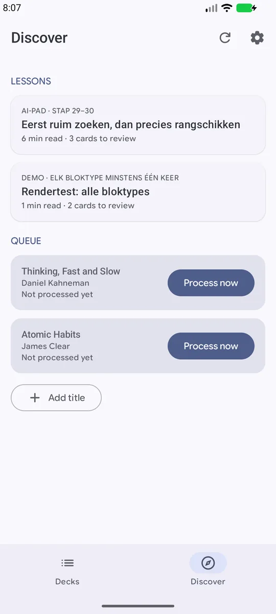
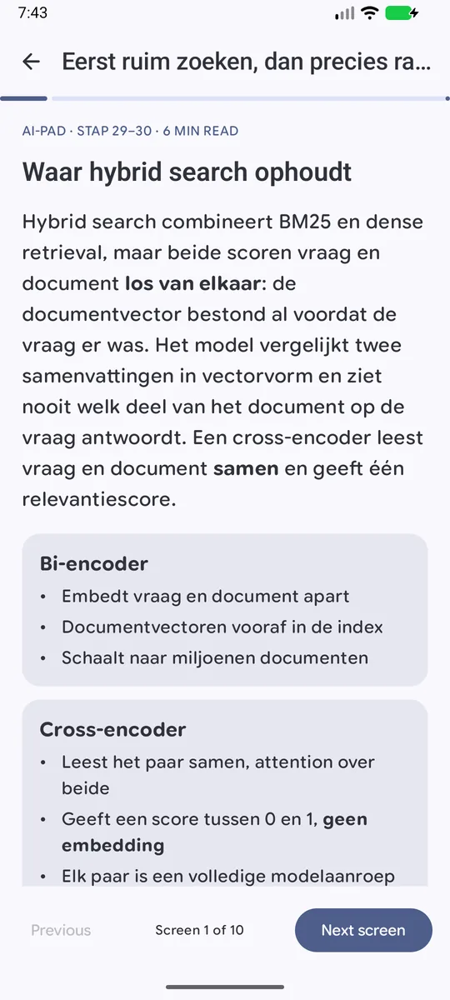
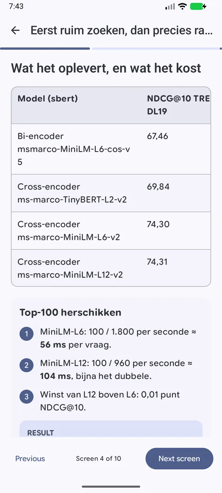
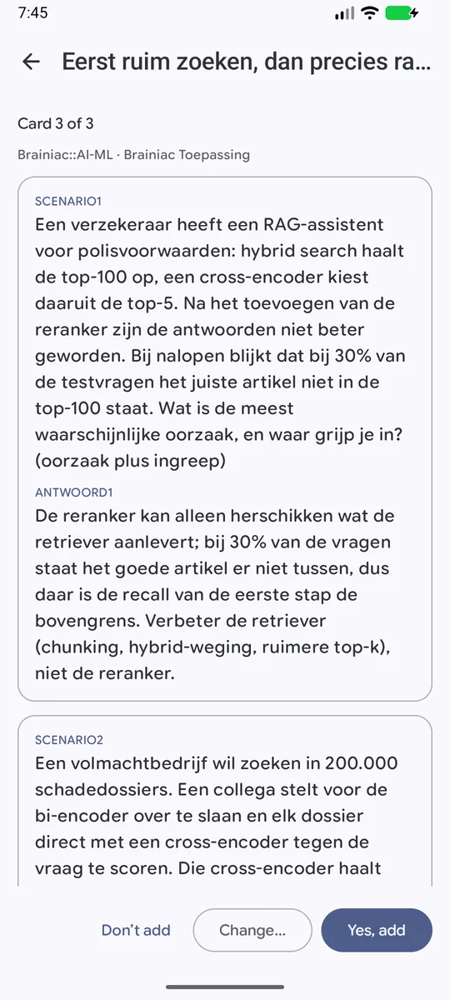

# Brainiac

Brainiac is a personal fork of [Hirameki](https://github.com/ColbyCabrera/Hirameki), which is itself a fork of
[AnkiDroid](https://github.com/ankidroid/Anki-Android). It adds a **Discover** tab: you read short lessons, then
decide card by card which of the suggested flashcards go into your collection. Discover needs a backend of your
own (see [Setting up Discover](#setting-up-discover)); everything else in the app is Hirameki and AnkiDroid as
they are.

> [!IMPORTANT]
> This is a personal project, not an official AnkiDroid or Hirameki release, and it is not affiliated with or
> endorsed by either project. Report problems with the base app to [Hirameki](https://github.com/ColbyCabrera/Hirameki/issues)
> only if they also occur in Hirameki itself.

## What the fork adds

- **Discover tab.** A list of open lessons and a queue of titles (books, learning paths) waiting to be turned into
  lessons. You can add a title to the queue and ask the server to process it.
- **Lessons in structured blocks.** A lesson is a series of screens built from text, callouts (key idea, pitfall,
  nuance, in practice), worked examples, side-by-side comparisons, tables, flows and code, followed by its sources.
- **Card suggestions.** After a lesson you review its suggested cards one by one:
  - **Yes, add** creates the note in your local collection, tagged `les::<lesson>`, and reports it to the server.
  - **Change…** lets you edit the card yourself before adding it, or send feedback so the card is rewritten.
  - **Don't add** asks for a reason (bad card, not interesting, already known, duplicate, other).

  When a lesson with added cards is finished, the app starts a sync.
- **Bottom navigation bar** on phones, with Decks and Discover. Tablets keep the navigation rail.
- **In-app updater** that installs new versions from this repository's GitHub Releases (see below).
- **Its own application id**, `nl.remcovolmer.brainiac`, so it installs next to Hirameki from Google Play instead
  of replacing it.

<p>




</p>

## Installing and updating

1. Download an APK from the [Releases page](https://github.com/remcovolmer/Hirameki/releases). Take
   `Brainiac-<version>-universal.apk` if unsure; `arm64-v8a` is smaller and fits almost every current phone.
   **Stay with the kind you chose**: the per-processor builds have higher version codes than the universal one, so
   Android refuses to install one kind over the other without uninstalling first.
2. Install it. Android asks you to allow installing apps from your browser or file manager. Brainiac installs next
   to Hirameki or AnkiDroid from Google Play and keeps its own collection.
3. To sync, set up AnkiWeb or your own sync server in the sync settings, the same way as in Hirameki.

**Updating.** The app checks for a new release at most once a day when it opens (this can be turned off), and on
demand under **Discover → settings → Check for updates**. A new version shows up as a banner on the Discover
screen. Tapping **Update** shows the versions, the download size and the release notes; after **Download and
install** the app downloads the APK of the kind you installed and checks its size, checksum, package name,
version and signing key before handing it to Android. Then:

- the first time, Android asks you to allow Brainiac to install apps ("Allow from this source"); go back afterwards;
- Android shows its own confirmation to update the app;
- Google Play Protect may ask to scan the app, because it does not come from the Play Store.

Your collection stays in place during an update. Android only installs an update signed with the same key as the
installed app, so a build signed with another key (for example one you built yourself) cannot be updated from
these releases, and the other way round.

## Setting up Discover

Open **Discover**, tap the settings icon and enter:

- **Server address**: the base URL of your backend, for example `http://your-server`;
- **App token**: the token the backend expects.

Until both are set, Discover shows a reminder instead of lessons. Plain `http` is accepted, so the backend is
meant to run on a network you trust (a home network or a VPN).

The backend is not part of this repository. It has to offer a small JSON REST API under `/api/v1` with a bearer
token:

- lessons: list the open ones, fetch one with its screens, sources and card suggestions, and mark it as read;
- card suggestions: accept a decision per card (added with the id of the new note, feedback, or rejected with a
  reason);
- a queue of sources: list, add, and start processing one.

The cards it suggests use the note type `Basic` (`Front`, `Back`) or `Brainiac Toepassing` (scenarios with their
answers and a key idea). That second note type has to exist in your collection before such a card can be added;
if it does not, the app says so and adds nothing. The exact contract is in the code:
[`DiscoverApi.kt`](AnkiDroid/src/main/java/com/ichi2/anki/discover/DiscoverApi.kt) and
[`DiscoverModels.kt`](AnkiDroid/src/main/java/com/ichi2/anki/discover/DiscoverModels.kt).

## Building and releasing

Build the sideload flavor locally with a JDK 21 and the Android SDK:

```
./gradlew :AnkiDroid:assembleFullRelease -Duniversal-apk=true
```

Releases are built by the **📦 Build & Release APK** workflow when a tag `brainiac-v<version>` is pushed, where
`<version>` has to equal `brainiacVersionName` in `AnkiDroid/build.gradle.kts` (the version code follows from it).
The workflow needs the signing key as repository secrets, runs the unit tests next to the build, and publishes the
APKs only if everything passes. Signing, the version scheme, the tag and asset names the updater depends on, and
which workflows are enabled are described in [BRAINIAC.md](BRAINIAC.md).

## Relation to upstream

- `main` mirrors [ColbyCabrera/Hirameki](https://github.com/ColbyCabrera/Hirameki) and gets no commits of its own.
- `brainiac/main` is the fork's own line and the base of every release; upstream is merged into it through `main`.
- The fork keeps its changes in separate files where it can (Discover, the updater, their strings), so upstream
  changes merge cleanly.

For the base app itself (its design, features and documentation) see the
[Hirameki README](https://github.com/ColbyCabrera/Hirameki#readme). Because Hirameki changes the UI considerably,
the [AnkiDroid manual](https://ankidroid.org/docs/manual.html) and
[wiki](https://github.com/ankidroid/Anki-Android/wiki) may not map one to one onto this app.

## Credits

Brainiac is built entirely on the work of [Hirameki](https://github.com/ColbyCabrera/Hirameki) by Colby Cabrera
and of the [AnkiDroid](https://github.com/ankidroid/Anki-Android) team and its contributors. Please consider
supporting them.

## License

This project inherits the licenses of the original AnkiDroid project:

* [GPL-3.0 License](https://github.com/ankidroid/Anki-Android/blob/main/COPYING)
* [AGPL-3.0 License](https://github.com/ankitects/anki/blob/main/LICENSE) for core back-end components.
* [LGPL-3.0 License](https://github.com/ankidroid/Anki-Android/blob/main/api/COPYING.LESSER) for the AnkiDroid API.
